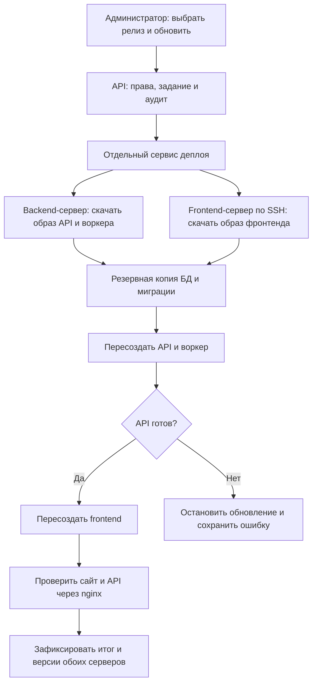

# Обновление прода одной кнопкой

## Результат для администратора

В админке появится раздел «Обновление системы»: текущая версия фронтенда и бэкенда, выбор опубликованного релиза, кнопка «Обновить прод», этапы выполнения и история запусков. Одно нажатие запускает обновление приложения на обоих серверах. Закрытие страницы и перезапуск API не прерывают задачу.

## Что уже есть в проекте

- `docker-build-push.sh` собирает образы frontend/backend из HEAD, публикует версию из package.json и тег latest.
- `deploy/docker-compose.backend.yml` запускает API, notification-worker и инфраструктуру. API и воркер используют один BACKEND_IMAGE.
- `deploy/docker-compose.frontend.yml` запускает frontend/nginx на другом сервере.
- `deploy/deploy.js` умеет запускать окружения раздельно; общего обновления двух серверов и обязательного pull перед запуском сейчас нет.
- В рабочем дереве есть текущие изменения пользователя: при реализации сохраняем их и ограничиваем правки задачей деплоя.

## Архитектура

Отдельный сервис деплоя работает на backend-сервере вне обновляемого API-контейнера. Он управляет локальным Compose и подключается к frontend-серверу по SSH. API принимает запрос администратора, создаёт задание и передаёт его сервису. Сервис сохраняет этапы в PostgreSQL; после перезапуска API интерфейс продолжает получать статус.

## Порядок обновления

1. Проверить доступность обоих серверов, Compose, выбранного релиза и отсутствие другого активного задания. Зафиксировать текущие digest образов.
2. Скачать оба образа параллельно. Использовать согласованную пару digest из манифеста релиза, чтобы изменение тега во время запуска не подменило версию.
3. Создать резервную копию PostgreSQL и проверить успешность её создания. При ошибке остановить запуск до миграций.
4. Включить режим обслуживания на время изменений схемы и остановить API/воркер, если миграции несовместимы с текущей версией. Выполнить миграции отдельным одноразовым контейнером из нового backend-образа.
5. Запустить API и notification-worker с новым образом. Дождаться готовности API с ограничением времени; проверить, что воркер работает.
6. При успехе обновить frontend, проверить сайт и API через nginx, снять режим обслуживания и записать успешный результат.
7. При сбое показать точный этап, состояние каждого сервера и доступное действие восстановления. Не продолжать обновление фронтенда после ошибки бэкенда.

Обновляются только frontend, backend и notification-worker. PostgreSQL, MinIO, OnlyOffice и прочие инфраструктурные сервисы не входят в обычный релиз приложения. Возможен короткий перерыв в работе; обновление без простоя — отдельная задача.

## Версии и восстановление

Сборка публикует манифест с номером версии, коммитом и digest обоих образов. Сервис получает список допустимых релизов из настроенного источника; произвольные имена образов и команды через интерфейс не принимаются.

Возврат предыдущих образов доступен только при совместимости с актуальной схемой БД. Автоматический откат миграций и автоматическое восстановление БД не выполняются: восстановление из копии может потерять записи, сделанные после её создания. При частичном обновлении интерфейс показывает фактические версии и сохраняет журнал для восстановления.

## Доступ и хранение

- Запуск разрешён только администратору системы; проверка выполняется на сервере. Имперсонация не даёт права запуска.
- Одновременно выполняется одно задание, блокировка хранится в PostgreSQL. Повторный запрос не создаёт второй деплой.
- В БД хранятся задания, этапы, версии, инициатор и настройки деплоя. Секреты SSH и токен сервиса передаются через окружение или файлы сервера, не через браузер.
- Сервис доступен только по внутреннему адресу с отдельной аутентификацией. SSH-команда на frontend-сервере ограничена операциями деплоя в заданной директории.
- Журналы очищаются от секретов; перезапуск сервиса приводит к сверке незавершённого задания с реальным состоянием контейнеров. Миграции вслепую повторно не запускаются.

## Этапы реализации

1. **Механизм обновления:** сервис, команды локального и удалённого обновления, конфигурация двух серверов, манифест релиза и фиксация digest.
2. **Хранение и API:** идемпотентные изменения в `backend/src/db/migrate.js`, задания и блокировка, маршруты проверки версий, запуска, истории и статуса. Обновить Swagger согласно правилам репозитория.
3. **Админка:** русские подписи, версия каждого сервера, выбор релиза, прогресс, ошибка и история. Настройки сохранять на сервере, без localStorage.
4. **Эксплуатация:** Compose для отдельного сервиса, примеры конфигурации без секретов, инструкции по установке SSH-доступа, резервным копиям и восстановлению.

## Проверка готовности

- Тесты оркестратора с подменой Docker/SSH: успешный запуск, ошибка pull на любом сервере, ошибка копирования БД, ошибка миграции, таймаут API, ошибка фронтенда и перезапуск сервиса.
- Тесты API: запрет для остальных ролей и имперсонации, один активный запуск, восстановление статуса после перезапуска API, отсутствие секретов в ответах.
- После изменений фронтенда обязательно выполнить `npm run lint` и `npm run typecheck`; проверить сборку и изменённые backend-файлы.
- На тестовом окружении из двух серверов подтвердить обновление одной версии на другую и поведение при частичном сбое. Проверить восстановление БД из резервной копии отдельно.

## Данные для подключения к реальному проду

Понадобятся адреса двух серверов, SSH-пользователь frontend-сервера, пути к Compose и .env, источник манифестов релизов, место хранения резервных копий и доступ сервису к БД. Реализацию можно подготовить с примерами значений; реальные секреты остаются на серверах.

Согласование этого плана запускает реализацию в репозитории. Подключение к серверам и обновление действующего прода выполняются после отдельного явного запроса пользователя.
